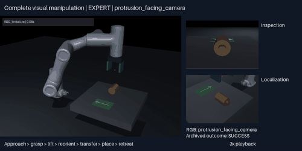
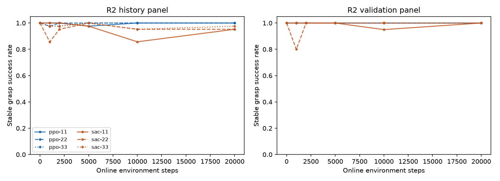
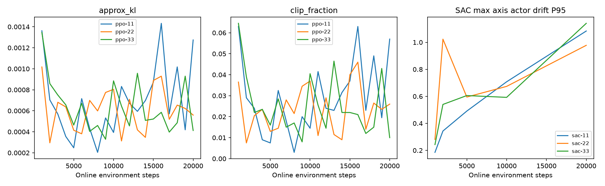
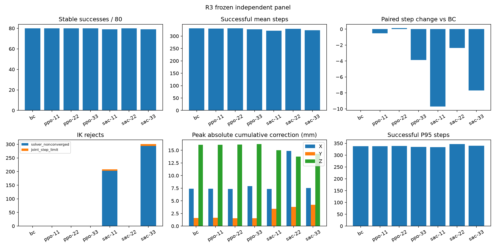

# CR3 MuJoCo Robot Learning Platform

**English** | [简体中文](README.zh-CN.md)

A reproducible MuJoCo platform for visual motor manipulation, demonstration collection, behavior cloning, and residual reinforcement learning.



RGB Expert completes pick, reorientation and placement for both initial part orientations. Playback is accelerated 3×. [Play or download MP4](docs/media/rgb-expert-demo.mp4) · [Complete visual manipulation demo and review clips](docs/MEDIA.md)

## Highlights

- **Visual Pick-and-Place** uses two RGB cameras to estimate the motor's orientation and XY position before continuous motion planning.
- **Learned Grasp & Lift** uses a frozen BC policy and a bounded residual policy, then hands the object to the placement planner without resetting physics.
- **LeRobot Dataset Pipeline** aligns dual RGB observations with robot state and executed actions and verifies 50 Hz physical replay.
- **PPO/SAC Research Benchmarks** compare three seeds per algorithm with the same task, observation and interaction budget.
- **Experiment Reproduction** includes tracked protocols, frozen numeric results and scripts for loading authorized checkpoints.

[System architecture](docs/PLATFORM.md#architecture-and-simulation)

## Quick Start

Use Python 3.12 on Linux. An EGL-capable OpenGL installation is required for the headless RGB renderer. Set `MUJOCO_GL=osmesa` if your host provides OSMesa instead.

```bash
python3.12 -m venv .venv
source .venv/bin/activate
python -m pip install -r requirements.txt
python scripts/fetch_cr3.py
python scripts/demo.py check quickstart
python scripts/demo.py rgb outputs/demo-rgb
```

Use `requirements.txt` for the demo, collection and research commands. The Public Core CI job uses `requirements-core.txt` for model and unit tests. LeRobot export uses its own interpreter as shown below.

The fetch script obtains pinned CR3 sources for local use. The RGB demo runs both fixed orientations and writes task results and complete GIFs. It needs no checkpoint. See the [asset inventory and distribution review](docs/ASSETS_AND_LICENSES.md) before repackaging any file.

## Demonstrations

The [media index](docs/MEDIA.md) lists both RGB Expert and hybrid learned runs, a paired BC/PPO/SAC success, data recording and replay, and the original SAC regression at scene 17721.

## Dataset Collection

Two 600×400 RGB cameras and a 20-dimensional proprioceptive state are aligned with a seven-dimensional executed action. The 10 FPS image pair is captured before the corresponding action. Every intervening 50 Hz action and physical integration state remains in the raw recording.

```bash
python scripts/demo.py collect outputs/demo-raw --episodes 2
python scripts/demo.py replay outputs/demo-raw
python scripts/demo.py export outputs/demo-raw outputs/demo-lerobot --lerobot-python /path/to/lerobot-env/bin/python
python scripts/demo.py verify-data outputs/demo-raw outputs/demo-lerobot --lerobot-python /path/to/lerobot-env/bin/python
```

## Run the platform

| Command | Behavior |
| --- | --- |
| `demo.py rgb OUTPUT` | Inspection RGB and localization RGB drive an expert that grasps, reorients, places and retreats. |
| `demo.py learned OUTPUT` | RGB initializes the task. Grasp & Lift uses 43-dimensional privileged simulation observations, then motion planning takes over in the same simulation state. |
| `demo.py collect RAW --episodes 6` | Record successful and failed demonstrations. RGB Expert is the default. |
| `demo.py export RAW DATASET --lerobot-python PYTHON` | Export LeRobot v3. Use `verify-data` for readback through the actual loader. |
| `demo.py replay RAW` | Replay the original actuator commands and verify the simulation state at 50 Hz. |
| `demo.py research OUTPUT` | Compare all seven frozen policies on a small development panel for Grasp & Lift. |
| `demo.py figures OUTPUT` | Rebuild learning curves and final comparison figures from tracked statistics. |
| `demo.py vision-bc OUTPUT --manifest RAW` | Evaluate the P4c RGB + proprioception BC checkpoint on its original local dataset. |

Run these commands from the repository root, for example `python scripts/demo.py figures outputs/demo-figures`. [Reproduction](docs/REPRODUCTION.md) covers required assets, raw dataset paths, archived media, and the frozen test protocol. [Platform documentation](docs/PLATFORM.md) describes coordinate frames, action semantics and control boundaries.

## RL Experiments

Rebuild the tracked comparison plots or evaluate the frozen PPO and SAC checkpoints on the same two development scenes:

```bash
python scripts/demo.py figures outputs/demo-figures
# Required only for checkpoint evaluation. Supply an authorized local source.
python scripts/demo.py restore research --source /path/to/private-asset-tree
python scripts/demo.py research outputs/research-development
```

The evaluation covers Grasp & Lift and writes per-episode results and a control trace. The checkpoint commands run deterministic inference. For the historical training setup and per-seed configuration, see the [R2 protocol](outputs/p5a-r2/protocol.json) and [experiment report](docs/P5A_R2.md).



R2 compares 20,000 online environment steps per seed, three seeds per algorithm. The historical and validation panel curves above are separate from the R3 independent test below. Both algorithms start from the same Residual BC initialization. Their update schedules and exploration objectives differ. ([Protocol](outputs/p5a-r2/protocol.json))

<details>
<summary>PPO update diagnostics and SAC policy drift</summary>



</details>

The independent panel contained 40 XY positions, each with both initial part orientations. Step differences are means over paired successes against Residual BC. Negative values indicate fewer steps.

| Strategy | Stable success | Paired Δ steps | IK rejections |
| --- | ---: | ---: | ---: |
| Residual BC, gain 0.25 | 80/80 | 0.00 | 0 |
| PPO seed 11 @ 2k | 80/80 | −0.51 | 0 |
| PPO seed 22 @ 5k | 80/80 | +0.13 | 0 |
| PPO seed 33 @ 20k | 80/80 | −3.88 | 0 |
| SAC seed 11 @ 2k | 79/80 | −9.71 | 208 |
| SAC seed 22 @ 5k | 80/80 | −2.35 | 0 |
| SAC seed 33 @ 5k | 79/80 | −7.68 | 301 |

Both SAC failures occurred in scene 17721 with the flat face towards Inspection. SAC seed 22 had a higher P95 completion length and higher peak X/Y correction than Residual BC. These results describe this simulation protocol and three seeds per algorithm. [Final report](docs/P5A_R3.md) · [Per-episode results](outputs/p5a-r3/episodes.csv)



## Reproducibility

Quick Start and new demonstration collection use locally fetched robot assets. Frozen policy rollouts and archive media require authorized copies. The numeric charts, protocols and per-episode CSV are tracked. [Reproduction and test matrix](docs/REPRODUCTION.md#presentation-and-test-tiers)

## Limitations

The full-task learned demo is a hybrid controller whose grasp policy uses 43-dimensional privileged simulation observations. The PPO/SAC evaluation covers Grasp & Lift. The experimental P4c RGB + proprioception BC scored 0/8 in full-task closed loop. There has been no real-robot evaluation. Reproducing frozen learned results requires authorized local checkpoints. [Vision BC diagnostics](docs/figures/vision-bc.png)

## License and Acknowledgements

The project's original source code is licensed under the [MIT License](LICENSE). Stable-Baselines3 retains its upstream license. See [Third-party notices](THIRD_PARTY_NOTICES.md).

Quick Start retrieves the CR3 model inputs locally from a pinned Dobot ROS2 commit. The project license applies to the project's own code. Robot assets, policy weights, datasets and rendered media have separate distribution terms. See [Assets and licenses](docs/ASSETS_AND_LICENSES.md).

[Project plan](docs/PROJECT_PLAN.md) · [Stage reports](docs/gripper_status.md)
