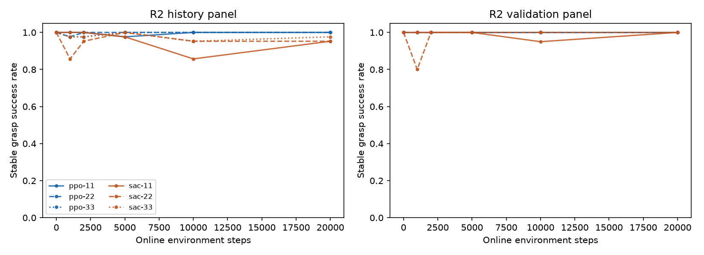
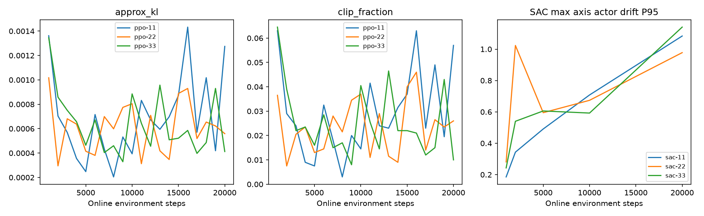
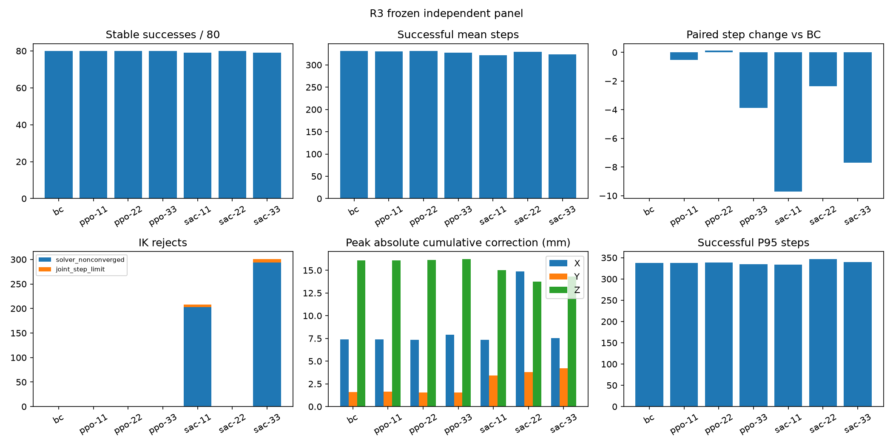

# CR3 MuJoCo 机器人学习平台

[English](README.md) | **简体中文**

基于 MuJoCo 的可复现平台，支持电机零件视觉定向抓放、示范采集、行为克隆和残差强化学习。

[完整抓放与演示素材索引](docs/MEDIA.md)

本地审阅包包含 RGB Expert 完成两种初始朝向的录像。视频取得分发授权后可嵌入 README。

## 核心功能

- **视觉抓放**使用双路 RGB 估计零件朝向和 XY 位置，再执行连续运动规划。
- **学习型抓取与抬升**在冻结 BC 策略上叠加有界残差，在同一仿真回合将物体交给放置规划器。
- **LeRobot 数据管线**将双路 RGB、机器人状态和执行动作按时间对齐，支持 50 Hz 物理回放校验。
- **PPO/SAC 研究基准**在相同任务、观测和环境交互预算下，每种算法比较三个随机种子。
- **实验复现**提供可追踪协议、冻结统计和授权 checkpoint 加载脚本。

[系统架构](docs/PLATFORM.md#architecture-and-simulation)

## 快速开始

在 Linux 上使用 Python 3.12。无头 RGB 渲染需要支持 EGL 的 OpenGL 环境；如果系统提供 OSMesa，可设置 `MUJOCO_GL=osmesa`。

```bash
python3.12 -m venv .venv
source .venv/bin/activate
python -m pip install -r requirements.txt
python scripts/fetch_cr3.py
python scripts/demo.py check quickstart
python scripts/demo.py rgb outputs/demo-rgb
```

演示、数采和研究评估使用 `requirements.txt`。Public Core CI 用 `requirements-core.txt` 安装模型与单元测试所需依赖。LeRobot 导出另用独立解释器，命令见下文。

下载脚本获取固定版本的 CR3 输入文件供本地使用。RGB 演示针对两种固定初始朝向运行并写出结果和完整 GIF，无需 checkpoint。重新打包文件前请查看[资产清单与分发审查](docs/ASSETS_AND_LICENSES.md)。

## 演示素材

[媒体索引](docs/MEDIA.md)包含 RGB Expert、混合式学习抓放、BC/PPO/SAC 同场景成功对照、数据采集和回放，以及场景 17721 的 SAC 退化案例。

## 数据采集

每个采集点将两路 600×400 RGB 图像、20 维机器人本体状态与 7 维执行动作对齐。10 FPS 的双路图像在对应动作执行前采集。原始记录保留全部 50 Hz 动作和物理积分状态。

```bash
python scripts/demo.py collect outputs/demo-raw --episodes 2
python scripts/demo.py replay outputs/demo-raw
python scripts/demo.py export outputs/demo-raw outputs/demo-lerobot --lerobot-python /path/to/lerobot-env/bin/python
python scripts/demo.py verify-data outputs/demo-raw outputs/demo-lerobot --lerobot-python /path/to/lerobot-env/bin/python
```

## 运行入口

| 命令 | 行为 |
| --- | --- |
| `demo.py rgb OUTPUT` | Inspection RGB 和 Localization RGB 引导专家抓取、重定向、放置和撤离。 |
| `demo.py learned OUTPUT` | RGB 初始化任务。Grasp & Lift 使用 43 维仿真特权观测，随后运动规划在同一仿真状态接管。 |
| `demo.py collect RAW --episodes 6` | 保存成功和失败示范，默认使用 RGB Expert。 |
| `demo.py export RAW DATASET --lerobot-python PYTHON` | 导出 LeRobot v3。用 `verify-data` 调用实际 Loader 读回。 |
| `demo.py replay RAW` | 逐步回放原始执行器指令并核验 50 Hz 仿真状态。 |
| `demo.py research OUTPUT` | 在 Grasp & Lift 开发面板上比较全部七个冻结策略。 |
| `demo.py figures OUTPUT` | 用 Git 跟踪的统计重建学习曲线和最终对比图。 |
| `demo.py vision-bc OUTPUT --manifest RAW` | 在原始本地数据集上评估 P4c RGB + 本体状态 BC checkpoint。 |

从仓库根目录运行，例如 `python scripts/demo.py figures outputs/demo-figures`。[复现指南](docs/REPRODUCTION.md)说明必需资产、原始数据路径、归档媒体和冻结测试协议。[平台文档](docs/PLATFORM.md)说明坐标系、动作语义和控制边界。

## 强化学习实验

重建已跟踪数据的对比图，或在同样的两个开发场景上评估冻结的 PPO 和 SAC checkpoint：

```bash
python scripts/demo.py figures outputs/demo-figures
# Required only for checkpoint evaluation. Supply an authorized local source.
python scripts/demo.py restore research --source /path/to/private-asset-tree
python scripts/demo.py research outputs/research-development
```

Grasp & Lift 评估输出逐回合结果与控制轨迹，加载 checkpoint 后执行确定性推理。原训练配置和逐种子设置见 [R2 协议](outputs/p5a-r2/protocol.json)及[实验报告](docs/P5A_R2.md)。



R2 每种算法使用三个种子，每个种子 20,000 个在线环境步。上图来自历史与验证面板，下文是单独的 R3 独立测试。两种算法从同一 Residual BC 开始，更新节奏和探索目标各有区别。[协议](outputs/p5a-r2/protocol.json)

<details>
<summary>PPO 更新诊断与 SAC 策略漂移</summary>



</details>

独立面板含 40 个 XY 位置，每个位置测试两种初始朝向。步数差只在两种策略共同成功的场景上配对计算，以 Residual BC 为基准。负值代表完成步数更少。

| 策略 | 稳定成功 | 配对步数差 | IK 拒绝 |
| --- | ---: | ---: | ---: |
| Residual BC, gain 0.25 | 80/80 | 0.00 | 0 |
| PPO seed 11 @ 2k | 80/80 | −0.51 | 0 |
| PPO seed 22 @ 5k | 80/80 | +0.13 | 0 |
| PPO seed 33 @ 20k | 80/80 | −3.88 | 0 |
| SAC seed 11 @ 2k | 79/80 | −9.71 | 208 |
| SAC seed 22 @ 5k | 80/80 | −2.35 | 0 |
| SAC seed 33 @ 5k | 79/80 | −7.68 | 301 |

两次 SAC 失败均发生在场景 17721，平面端朝向 Inspection 相机。SAC seed 22 的完成步数 P95 和 X/Y 修正峰值均高于 Residual BC。结果适用于此仿真协议和每种算法的三个训练种子。[最终报告](docs/P5A_R3.md) · [逐回合结果](outputs/p5a-r3/episodes.csv)



## 复现

快速开始与新示范采集使用本地下载的机器人资产。冻结策略评估与归档媒体需要授权副本。数值图表、协议和逐回合 CSV 由 Git 跟踪。[复现及测试矩阵](docs/REPRODUCTION.md#presentation-and-test-tiers)

## 局限

完整学习型抓放由混合控制器执行，抓取策略使用 43 维仿真特权观测。PPO/SAC 评估覆盖 Grasp & Lift。P4c 的 RGB + 本体状态 BC 在完整闭环任务中为 0/8。该平台尚未在真实机器人上评估，复现冻结策略需要授权 checkpoint。[视觉 BC 诊断](docs/figures/vision-bc.png)

## 许可证与致谢

项目自研源码采用 [MIT 许可证](LICENSE)。Stable-Baselines3 沿用上游许可证。详见[第三方声明](THIRD_PARTY_NOTICES.md)。

快速开始会从 Dobot ROS2 仓库的固定提交在本地获取 CR3 模型输入。项目许可证适用于自研代码。机器人资产、策略权重、数据集和渲染媒体的分发条款单独处理。[资产与许可](docs/ASSETS_AND_LICENSES.md)

[项目计划](docs/PROJECT_PLAN.md) · [阶段报告](docs/gripper_status.md)
