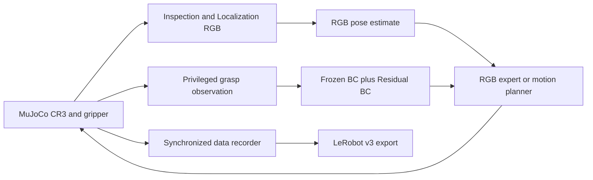

# Platform

## Architecture and simulation

World +X points into the table, +Y to the robot's left, +Z up. CR3 Base axes align with World, with the base 30 mm above the World origin. The TCP is 100 mm along flange +Z. The part starts left with its protrusion along ±Y and finishes at the right target with its protrusion along −X. The motor body measures 52 × 76 mm. Joint state uses rad and rad/s, position uses m, and quaternions use MuJoCo wxyz. The simulator integrates ten 2 ms steps per 50 Hz control period. The full task scores position within 15 mm, orientation within 10°, and stable table placement.

P2b consumes RGB and camera calibration for visual planning. P4a adds privileged-state grasp and lift, then hands over the current joints, TCP and gripper command to the existing planner in one physics episode. [RGB audit](gripper_status.md) · [Continuous handoff](P4A.md)

## Dataset and Behavior Cloning

The default state is 20-dimensional in the order six joint positions, six joint velocities, measured jaw aperture in m, TCP position and TCP quaternion. The action contains six final joint target values and the gripper closure command in [0,1]. Both 600×400 RGB views share the pre-action simulation instant every fifth control tick. Each retained visual row is aligned with the command beginning at that tick. The original 50 Hz log preserves all commands in between. RGB + proprio BC training in P4c grouped five consecutive 20 ms commands from that tick into a 5×7 chunk. Only complete chunks within successful episodes were used as positive demonstrations. Oracle diagnostics are separate.

The P4c checkpoint produced 0/8 full-task completions in closed-loop evaluation despite low validation prediction error on expert states. Deployment investigates covariate shift using the original checkpoint. [Format and loader](P4B.md) · [Chunk training and deployment](P4C.md)

## Residual RL and experiments

The default learned grasp uses frozen 40D BC and Uniform Residual BC with gain 0.25. Three budget states produce the 43D privileged residual observation. The XYZ-only learned correction passes through the existing scale, workspace limits, signed episode budget of ±(6,3,12) mm and IK. The gripper follows frozen BC. Residual PPO/SAC experiments use the same Grasp & Lift task and success criteria. The final frozen comparison used deterministic inference. The 20/5/22 mm absolute cumulative values are empirical review thresholds. [Research protocol](P5A_R2.md) · [Final comparison](P5A_R3.md)
